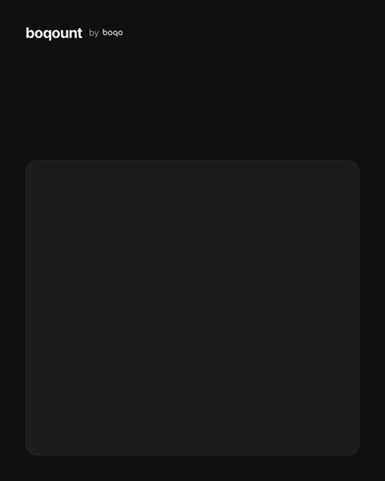

<p align="center">
  
</p>

<h1 align="center">boqount</h1>

<p align="center"><b>Your AI agent runs your brand's Instagram, TikTok and YouTube.</b><br>
It reads your project, makes films from scratch in your style, checks every post, asks you before anything goes
out, and measures what worked.</p>

<p align="center"><sub>The film in the demo is the example the skill ships, made for an invented plant app.</sub></p>

## Start in three steps

1. On your computer, open Claude Code (or another agent that runs skills) in your project's folder.
2. Paste this line into the chat:

   ```
   Install the boqount skill: read https://raw.githubusercontent.com/boqo-ai/boqount/main/INSTALL.md and follow it.
   ```

3. Answer its questions. It reads your project, tells you what it understood, and shows you a first short film in
   your brand's colours and words. Nothing is posted without your yes.

**Reading this on your phone?**
[Email the line to yourself](mailto:?subject=boqount%3A%20paste%20this%20into%20your%20agent&body=Open%20Claude%20Code%20%28or%20another%20agent%20that%20runs%20skills%29%20in%20your%20project%27s%20folder%20and%20paste%20this%20line%20into%20the%20chat%3A%0A%0AInstall%20the%20boqount%20skill%3A%20read%20https%3A//raw.githubusercontent.com/boqo-ai/boqount/main/INSTALL.md%20and%20follow%20it.%0A%0Ahttps%3A//github.com/boqo-ai/boqount)
and paste it on your computer, or star the repository to find it again.

## What it does

- **Learns your brand from your own files:** the README and docs, the site, prices, the logo and colours, your
  public profiles. Every fact it uses carries its source.
- **Finds a style with you:** it researches your niche and shows two or three style directions on real examples.
  You pick; nothing comes from a fixed template.
- **Makes films from scratch,** drawn in code in your brand's style: niche episodes that loop and never show the
  product, and product films that open on a sourced number and end on one comment call.
- **Checks every post** against your brand book and its own rules, and holds anything that fails.
- **Asks you before it posts,** until you have approved as many posts as you chose. Then it may post alone, and it
  stops itself when the numbers drop or a link breaks.
- **Measures every post** and plans the next ones from what worked: reach, follows, sign-ups and sales against
  targets it sourced.

## What it needs

- An agent that runs skills, such as [Claude Code](https://claude.com/claude-code). The skill runs on your agent's
  plan.
- Node 20 or newer and ffmpeg. For films, about 1 GB of disk (the film project needs Node 20.19, 22.13 or newer).
- That's it to start. The skill is free and open source (MIT). It checks what is missing and installs nothing
  without your yes.

Optional:

- **A boqo account,** recommended for the full experience: with it the agent publishes and schedules to your
  connected accounts, reads the numbers itself and cuts clips from your long videos. Without it, the agent hands you
  each post (file, caption, time) to publish yourself.
- **An ElevenLabs key** for a voice and a bigger sound library. Without one, films are voice-free, the words on
  screen, with a free synthesized sound kit.
- Films use [Remotion](https://www.remotion.dev/docs/license): free for individuals and companies of up to three
  people, a company licence otherwise.

## What it never does

- Post without your approval while it is calibrating. You can pause it at any time.
- Buy ads or views.
- Put more than one call in a post. A product film ends on "Comment &lt;code&gt;, and I'll send you the link.", and
  only once you have confirmed who sends that link (your DM automation, or you by hand). Niche episodes ask for
  nothing. Never "follow", never "link in bio".
- Write to GitHub, push, or install anything without your word.
- Print a key.

<details>
<summary><b>What happens after you paste the line</b></summary>

The agent copies the skill to your machine and starts onboarding in the folder you opened it in:

1. It asks once whether its files may be created in this folder, and whether to commit them.
2. It reads your project: the README and docs, the site's pages, prices, the product's own words, the logo and
   colours, earlier marketing, recent changes, and your public profiles.
3. It says back what it understood, with a source for each point, and asks what is wrong.
4. It shows you a first short film in your brand's colours and words, if you want films made here (the film project
   needs about 1 GB and your yes). It is a first look, never posted.
5. It asks only what no file could tell it: what the account sells and to whom, what is off limits, which channels,
   the budget, how many posts you want to approve before it may post alone, how you count sign-ups, who answers a
   comment that asks for the link (a DM automation you run, or you by hand), your time zone and when to post.
6. It drafts a brand kit from all that for your approval.
7. It researches a strategy with you: the account's goal, named series, a twelve-week calendar, benchmarks from
   sources, and two or three style directions on real examples to choose from.
8. It drafts your profile's bio, link and pins for you to set, and proposes a first week of three posts. Nothing is
   posted during onboarding.

Onboarding and research may start several helper agents at once, which uses more of your plan.

</details>

<details>
<summary><b>What it does every day</b></summary>

Run `/boqount`. It reads its config and state, checks that your links still open, reads the numbers of posts that
are due, learns from them, plans the next two or three days, makes the posts that are missing, checks each one
against your brand book and its own rules, sends you each post for approval (caption, time and file together), and
publishes it or hands it to you. It ends with a list of comments to answer and a short report.

It posts at most twice a day on a channel, only in the time windows you set, within your budget.

</details>

<details>
<summary><b>What it makes</b></summary>

- **Films from scratch,** drawn in code in a Remotion project in your folder, in your brand's style, with on-screen
  words and sound placed to the picture (a free synthesized kit, or a larger library you generate with your own
  ElevenLabs key), in two shapes:
  - **episodes of your niche series,** 27 to 30 seconds, that loop and never show the product: one travelling camera
    through one world, each step shown happening rather than labelled, something new for the eye about every second;
  - **films that show your product,** 60 to 85 seconds, in the "opportunity story" format: a sourced number about
    something everyone knows on the first frame, an opening the viewer can step into, the product named only near the
    end, scenes that change on their words, captions that carry it with the sound off, and one last line, "Comment
    &lt;code&gt;, and I'll send you the link." This format comes from a single reference film, so the skill treats it
    as a test until two of your own films in it have been measured.

  The agent judges a film from its stills and the file's own words; it does not watch it at speed or listen to it,
  and every approval message says so.
- **Clips** cut from your own long video (needs the optional boqo account).
- **Your own files**, checked and captioned.
- **Slideshows** made from stills you already have.

The skill ships a starter film for an invented plant-care app, made in the opportunity-story format: a
demonstration of the project, never a post. It opens on a number already counting, changes world on its words, keeps
its captions in one band, names the app only near the end, and closes on the comment arriving and its reply:
"Comment FERN, and I'll send you the link." A niche episode starts from the project's looping template instead.

</details>

<details>
<summary><b>The optional boqo account</b></summary>

boqo is a service that publishes and schedules posts to your connected Instagram, TikTok and YouTube accounts and
cuts clips from long videos. It is connected to the agent through its MCP server, `https://mcp.boqo.ai/mcp` (in
Claude Code: `claude mcp add --transport http boqo https://mcp.boqo.ai/mcp`). With it, the agent publishes and
schedules, reads the numbers without you, and cuts clips from a long video. Without one, the skill prepares every
post and hands you the file, the caption and the time; you publish it and send back the link, and the numbers come
from your screenshots or the figures you type.

</details>

<details>
<summary><b>Commands</b></summary>

| Command | What it does |
|---|---|
| `/boqount` | The day's run |
| `/boqount status` | A report of where things stand; changes nothing |
| `/boqount screens` | Reads the screenshots of your posts' numbers |
| `/boqount post <file or idea>` | Checks a file you made, or turns an idea into a planned post |
| `/boqount week` | The weekly roll-up: KPIs against their targets, what sold, the bets for next week |
| `/boqount research` | Hands over to `/boqount-research` |
| `/boqount config` | Shows the settings; `set <key> <value>`, `pause`, `resume` |
| `/boqount onboard` | Runs onboarding, or resumes it where it stopped |
| `/boqount-research` | `launch`, `refresh` or `focus <topic>`: the strategy, the benchmarks and the style |

</details>

<details>
<summary><b>The files it creates in your folder</b></summary>

- `marketing/`: the config, the state, the log, the queue, the ledger of posts, the strategy, one record per post.
- `brand/<your-brand>/`: the brand book, the accounts, the assets, the style.
- `films/`: the film project and one folder per film, when you want films made here.
- `.boqo-upload/`: working files, git-ignored.

Your keys are never stored in these folders. `examples/quillfern/` shows the files after onboarding, for an invented
brand.

</details>

<details>
<summary><b>Installing by hand, updating, removing</b></summary>

For Claude Code:

```sh
git clone --depth 1 https://github.com/boqo-ai/boqount ~/.boqount
mkdir -p ~/.claude/skills
ls -ld ~/.claude/skills/boqount ~/.claude/skills/boqount-research
```

If either name already exists, leave it: a link to `~/.boqount/skills/` is installed already, and anything else is
yours to move first. Then link the names that do not exist (`-n`, so an existing folder is never entered):

```sh
ln -sn ~/.boqount/skills/boqount ~/.claude/skills/boqount
ln -sn ~/.boqount/skills/boqount-research ~/.claude/skills/boqount-research
```

Then open Claude Code in your project's folder and run `/boqount onboard`.

Or as a Claude Code plugin, from the boqo-plugins catalog: `/plugin marketplace add boqo-ai/boqo-plugins`, then
`/plugin install boqount@boqo-plugins`. A plugin's commands carry its name: `/boqount:boqount onboard`, and so on.
Use one way or the other, not both.

Updating (your account's files are not touched):

```sh
git -C ~/.boqount pull --ff-only
```

Removing:

```sh
rm ~/.claude/skills/boqount ~/.claude/skills/boqount-research
rm -rf ~/.boqount
```

Use the skills folder you installed into, if it was another. This leaves your project's `marketing/`, `brand/` and
`films/` folders as they are; delete them yourself if you no longer want them. A key you saved is in
`~/.config/boqount/`.

</details>

## Licence

The code is MIT; see [LICENSE](LICENSE). The bundled Inter font is under the SIL Open Font License 1.1; its text is
beside the font, in
[`skills/boqount/films/project/shared/fonts/OFL-Inter.txt`](skills/boqount/films/project/shared/fonts/OFL-Inter.txt).
